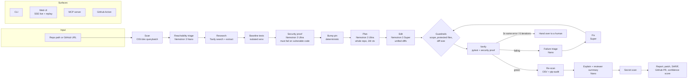

# Leaply Guard

**Your repo has a known vulnerability. The fix needs a major version bump that breaks your code. Leaply Guard upgrades it and proves it with your tests.**

Built for the Nebius × NVIDIA Global AI Hackathon (Coding and Agentic Engineering track) with **NVIDIA Nemotron 3 Ultra, Super and Nano on Nebius Token Factory**, plus **Tavily** for live research and **OSV.dev** for vulnerability data.

<!-- DEMO GIF: record the replay at http://localhost:8000/?replay=1, save as docs/demo.gif, then replace this comment with:  -->

---

## The problem

Dependabot and `pip-audit` tell you that `PyJWT 1.7.1` has CVE-2022-29217 and that the fix is `>= 2.4.0`. They do not tell you that 2.x changes `jwt.encode` to return `str`, makes `algorithms=` mandatory and removes `verify=False`. So the bump PR goes red, nobody owns it, and the vulnerable version stays in production for months.

Bump PRs that only change a version are easy. The ones that sit open are the **breaking** ones. Leaply Guard is for those.

## What it does

1. **Scan.** Parses `requirements*.txt`, `pyproject.toml` and `package.json`, queries **OSV.dev** (`/v1/querybatch` + `/v1/vulns/{id}`), merges GHSA/PYSEC/CVE aliases and computes CVSS 3.x scores.
2. **Reachability triage (Nemotron 3 Nano).** Finds every import and call of the package and classifies each finding as `REACHABLE`, `POSSIBLY REACHABLE` or `NOT USED`, citing `file:line` evidence. Findings are ranked by severity × reachability. This is what a plain scanner does not give you.
3. **Research (Tavily).** At runtime, searches for the advisory and the official migration guide / changelog, extracts the top pages, and shows every source in the UI and the report.
4. **Baseline.** Copies the repo to a temp dir, creates its own virtualenv, and runs the test suite.
5. **Security proof (Nemotron 3 Ultra).** Ultra writes a pytest regression test for the specific CVE (for CVE-2022-29217: an HS256 token forged with the service's *public* key must be rejected). It only counts if it **fails on the vulnerable version for the right reason** (attack accepted, not an import error). If it does not validate, a vetted template is used and the report says so.
6. **Bump.** Deterministic edit of the pin, fresh venv, tests again. This is the red moment: the upgrade breaks the code.
7. **Plan (Nemotron 3 Ultra).** The whole repository (1M-token context), the failing output and the research go into one call that returns a JSON plan: files, exact changes, why, risk.
8. **Edit (Nemotron 3 Super).** Applies the plan file by file as unified diffs. Hunks are located by content, so wrong line numbers do not break them. If a diff does not apply, Super returns the full file instead.
9. **Verify + fix loop (Nano triage, Super fixes).** Runs the tests. On failure, Nano classifies the error and picks the files, Super patches them, and the tests run again. Max 6 iterations. If the same error repeats 3 times, the run stops and hands over to a human with a list of what it tried.
10. **Re-scan.** OSV (and `pip-audit -f json` if installed) on the new version: "0 known vulnerabilities for PyJWT 2.15.1".
11. **Explain (Nemotron 3 Nano).** One plain-English line per changed file plus a reviewer summary: what changed, risk, what to double-check.
12. **Deliver.** Markdown report, `changes.patch`, SARIF 2.1.0, a confidence score, and either a **real GitHub pull request** (if `GITHUB_TOKEN` is set) or the PR body in `report.md`. Optionally, a local git branch with a commit. Nothing is auto-merged.

## Architecture



Every step emits events on one bus (`leaply_guard/events.py`). The CLI prints them, the web UI streams them over Server-Sent Events, and a finished run is saved as JSON that the UI can replay.

## How we use NVIDIA Nemotron and Nebius Token Factory

All model calls go through the OpenAI Python client pointed at Token Factory (`https://api.tokenfactory.us-central1.nebius.com/v1/`). Model IDs are checked against `/v1/models` on first use (`leaply-guard models`), with case fixes and closest-match resolution. Every call has a timeout, retries with exponential backoff, and is recorded with model, purpose, tokens, latency and cost.

| Step | Model | Why this model |
|---|---|---|
| Migration plan | **Nemotron 3 Ultra** | The plan needs the whole repository, the failing tests and the migration guide in one context to catch every call site. Ultra's 1M-token window means no retrieval and no missed files. It runs once per fix, so its price is paid once. |
| Security regression test | **Nemotron 3 Ultra** | A test that reproduces an attack must be exactly right (key formats, token structure). That is worth the strongest reasoning, and it is validated by execution before it counts. |
| File edits, test fixes | **Nemotron 3 Super** | Many small, focused calls (one file at a time), with code quality close to Ultra at about a third of the price. |
| Reachability, failure triage, per-file explanations, reviewer summary | **Nemotron 3 Nano** | Classification and short summaries: high volume, low difficulty. Nano is about 16× cheaper than Ultra on input. |

**Routing savings.** The cost panel and report also price every call as if it had gone to Ultra and show the difference as "% saved by model routing". Prices are configurable (`PRICE_ULTRA_IN`, etc.). Defaults are Ultra $1/$3, Super $0.30/$0.90, Nano $0.06/$0.24 per 1M input/output tokens.

## How we use Tavily

Tavily is called at runtime for every fix, not just at development time:

- `POST /search` (advanced depth) for the advisory (`CVE-… PyJWT security advisory`) and for the migration guide (`PyJWT 1.x to 2.0 migration guide breaking changes changelog`).
- `POST /extract` on the top 5 results, reranked for "breaking changes", which feeds into Ultra's planning and security-test prompts.
- Every source is shown in the UI, marked `EXTRACTED` when its content was used, and listed in the PR body.

Without a Tavily key, the run still works from the OSV advisory references and says so in the log.

## Trust and safety

- **Guardrails on every edit:** only files inside the target repo; never `.env*`, CI config, lockfiles, keys or secrets files; never test files (the tests are the proof, so they are not rewritten to pass), except the security proof that Leaply Guard adds itself. A diff that touches a file outside its own edit is rejected. Violations are shown in the UI and the report ("guardrails: passed").
- **Secret scan** of the final diff (AWS, GitHub, OpenAI-style, Slack, Tavily keys, private key blocks, generic credentials). Any hit blocks the branch and PR.
- **Limits, configurable and shown in the UI:** max fix iterations (6), same-error handover (3), max diff size (400 lines).
- **The sandbox never sees our keys:** `NEBIUS_API_KEY`, `TAVILY_API_KEY` and `GITHUB_TOKEN` are removed from the environment of every command it runs.
- **Audit log:** every model call (model, purpose, tokens, latency, cost), every command (exit code, duration), every file changed and every guardrail decision. Downloadable as JSON from the UI and stored in `runs/<run_id>.json`.
- **Confidence score** (0 to 100): tests passing, security proof red → green, iterations used, diff size, remaining vulnerabilities. Low confidence or a handover shows **Needs human review** with what was tried.
- **No auto-merge, ever.**

## Explainability

- One plain-English line next to each changed file (Nano).
- A reviewer summary at the top of the report: what changed, risk, what a human should double-check.
- Side-by-side or unified diff with syntax highlighting (diff2html).

## Quick start (local)

Requirements: Python 3.11+, git. [`uv`](https://github.com/astral-sh/uv) is optional but makes the sandbox venvs much faster.

```bash
python -m venv .venv && . .venv/bin/activate      # Windows: .venv\Scripts\activate
pip install -e ".[dev]"
cp .env.example .env                              # add NEBIUS_API_KEY and TAVILY_API_KEY

leaply-guard models                               # confirm the Nemotron 3 model ids on Token Factory
leaply-guard ping                                 # one call each to Nano, Super, Ultra
leaply-guard scan                                 # scan + triage the bundled demo repo
leaply-guard run --package PyJWT --save-replay pyjwt-demo   # the full pipeline, saved as a UI replay
leaply-guard serve                                # http://127.0.0.1:8000
```

CLI:

```bash
leaply-guard run --repo PATH_OR_GITHUB_URL --package NAME --target VERSION [--branch] [--pr]
                 [--max-iterations 6] [--max-diff-lines 400] [--keep] [--save-replay NAME]
leaply-guard scan --repo PATH_OR_GITHUB_URL [--json]
leaply-guard save-replay RUN_ID --name pyjwt-demo
```

Run the project's own tests (offline, no keys needed; real OSV, real venvs, scripted model answers):

```bash
pytest -q
```

## The demo repo

`demo/vulnerable-app` is a small Flask auth service (login, refresh, `/me`, service-to-service tokens signed with ES256) pinned to **PyJWT 1.7.1**. It uses the 1.x API in three files: `jwt.encode(...).decode("utf-8")`, `jwt.decode` without `algorithms`, and `jwt.decode(token, verify=False)`.

| State | Test suite | Security proof (forged HS256 token) |
|---|---|---|
| PyJWT 1.7.1 | 15/15 pass | **fails**: attack accepted |
| PyJWT 2.15.1, code unchanged | 3/16 pass | — |
| PyJWT 2.15.1 + Leaply Guard | 16/16 pass | **passes**: attack rejected |

## Web UI

- Landing section with the pitch, a **Run live demo** button and the Scan → Fix → Prove steps.
- **Scan** any repo (or the preset), pick a finding, click **Fix**.
- Live agent timeline with a model badge on every step (ULTRA / SUPER / NANO / TAVILY / OSV / SANDBOX), a live activity ticker and a running cost counter.
- Test bar that goes red then green, with a history row per stage; a separate **Security proof** badge (attack accepted → attack rejected).
- Migration plan, reviewer summary, diff viewer with a per-file explanation, sources, guardrails, confidence.
- Final result card ("CVE closed · 16/16 tests · security proof passing · N iterations · $X · Y% saved by routing") with **Copy as markdown**.
- Downloads: audit log (JSON), report / PR body (Markdown), SARIF 2.1.0.
- **Replay mode:** a saved live run plays back at 6× speed, clearly labelled `REPLAY · recorded live run` (live runs are labelled `LIVE · real model calls`). Only successful live runs can be saved as replays. `/?replay=1` opens it directly; add `&speed=max` to jump to the result.
- **Accessibility:** dark and light mode (follows the system, with a toggle), works at phone width, keyboard-operable controls with visible focus rings, ARIA labels on the test bar and toggles, `aria-live` regions for the timeline and result, a skip link, and `prefers-reduced-motion` support.

## MCP server

Use Leaply Guard from any MCP client. Tools: `scan_repo(path)`, `triage(finding_id)`, `fix(finding_id, target_version?)`, `get_report(run_id)`.

**Claude Code**

```bash
claude mcp add leaply-guard -- leaply-guard mcp
# or, without installing: claude mcp add leaply-guard -- python -m leaply_guard mcp
```

**Cursor** (`~/.cursor/mcp.json`) and **Hermes Agent** (its MCP servers config) use the same stdio entry:

```json
{
  "mcpServers": {
    "leaply-guard": {
      "command": "leaply-guard",
      "args": ["mcp"],
      "env": { "NEBIUS_API_KEY": "…", "TAVILY_API_KEY": "…" }
    }
  }
}
```

Then ask: *"Scan this repo for vulnerable dependencies, triage them, and fix the reachable ones."*

## GitHub Action

`.github/workflows/leaply-guard.yml` is a template for your own repository. It scans weekly (and on demand), and for every **reachable HIGH/CRITICAL** finding runs the fix and opens a pull request with the report as the body. Reports are uploaded as a build artifact. It needs a `NEBIUS_API_KEY` secret (and optionally `TAVILY_API_KEY`).

## Deploy (public demo)

The Docker image serves the web UI with `LEAPLY_HOSTED=1`: live runs are limited to the bundled demo repo, rate limited per visitor (`LIVE_RUNS_PER_HOUR`, default 3) and globally (`LIVE_RUNS_PER_DAY`, default 40), at most 2 at once, and cannot open PRs. The replay always works.

```bash
docker build -t leaply-guard .
docker run -p 7860:7860 -e NEBIUS_API_KEY=… -e TAVILY_API_KEY=… leaply-guard
```

**Render:** New → Blueprint → select this repo (`render.yaml`), then set `NEBIUS_API_KEY` and `TAVILY_API_KEY`.
**Hugging Face Spaces:** create a Docker Space, push this repo to it, and add the two keys as Space secrets. Port 7860 is the default.
Full steps: [docs/DEPLOY.md](docs/DEPLOY.md).

## Known limitations and failure cases

- **Python first.** Scanning reads `package.json` too, but the fix pipeline (venv, pytest) is Python only.
- **Only exact pins are scanned** (`==`). Ranges like `flask>=2.3` are not resolved, so a vulnerable resolved version can be missed. A lockfile resolver is the next step.
- **Tests are the oracle.** If a repo has weak tests, "green" means less. The confidence score includes test count, but cannot know coverage. Repos with no tests get a low score and "needs human review".
- **The security proof is per-advisory.** Ultra writes it, but it only counts if it fails on the vulnerable code for the right reason. The vetted template exists only for CVE-2022-29217. For other advisories, an unvalidated test is discarded and the report says "no proof", rather than claiming one.
- **Reachability is static.** Nano reasons over import and call sites found by pattern matching, not a call graph. Dynamic imports and reflection can be missed. Verdicts come with evidence so a human can check.
- **The sandbox is a separate venv, not a container.** It keeps our API keys out of the environment, but the code under test runs with the user's permissions. Run untrusted repos inside the Docker image. A Nebius Serverless job sandbox is on the roadmap.
- **The upgrade target is the latest release by default.** That closes the most advisories, but is a bigger jump than the minimum fixed version. Use `--target` to choose.
- **Model answers vary.** The fix loop and guardrails absorb most of it (wrong line numbers, extra files, missing allow-lists), but a run can still end in a handover. That is reported honestly, not hidden.
- **Monorepos and multiple dependency files** are scanned, but one run fixes one package in one project root.

## What was built during the hackathon

Leaply Guard is new code, written during the hackathon. It builds on the ideas of **Leaply** (my earlier project, `Migrator`), a TypeScript tool that migrates customer code when an API ships a breaking change (OpenAI SDK v0 → v1 pack, ast-grep rules first, LLM for leftovers, validation before and after, a human approves every PR).

Carried over as **ideas** (no code was copied; Leaply is TypeScript, Leaply Guard is Python):
- Deterministic edits first (the version pin is bumped by code, not by a model), and the model only for what rules cannot do.
- Validate before and after with the repo's own tests, and count "passed" only on an observed exit code.
- Constrain what the model may touch, and reject answers that reach outside it.
- Numbers in reports are counted from the run, never estimated. No auto-merge.

New in Leaply Guard:
- The security angle: OSV scanning, alias merging, CVSS scoring, and reachability triage.
- Three-model routing on Nebius Token Factory (Nemotron 3 Ultra / Super / Nano), with per-call cost accounting and routing savings.
- Runtime research with Tavily.
- The executable security proof (red on vulnerable code, green after the fix), with validation.
- The fix loop with failure triage and same-error handover.
- Guardrails, secret scan, audit log, and confidence score.
- Web UI with SSE streaming and replay; MCP server; GitHub Action; SARIF export; Docker deploy with hosted-mode rate limits.
- The demo vulnerable app and its test suite.

## Repository layout

```
leaply_guard/
  scan.py         OSV.dev scan, alias merge, CVSS 3.x
  triage.py       usage search + Nano reachability
  research.py     Tavily search + extract
  agents.py       prompts: Ultra plan / security test, Super edit / fix, Nano triage / explain
  pipeline.py     orchestration, fix loop, confidence
  workspace.py    temp copy, venv, pytest + JUnit parsing
  patching.py     content-anchored unified diff applier
  guardrails.py   edit scope rules, secret scan
  report.py       report / PR body, GitHub PR, SARIF
  llm.py          Token Factory client, retries, ledger
  server.py       FastAPI + SSE + replay + rate limits
  mcp_server.py   MCP tools
  web/index.html  the UI
  proofs/         vetted security tests
demo/vulnerable-app/  the PyJWT 1.7.1 demo service
tests/                offline end-to-end and unit tests
```

## License

MIT, see [LICENSE](LICENSE).
